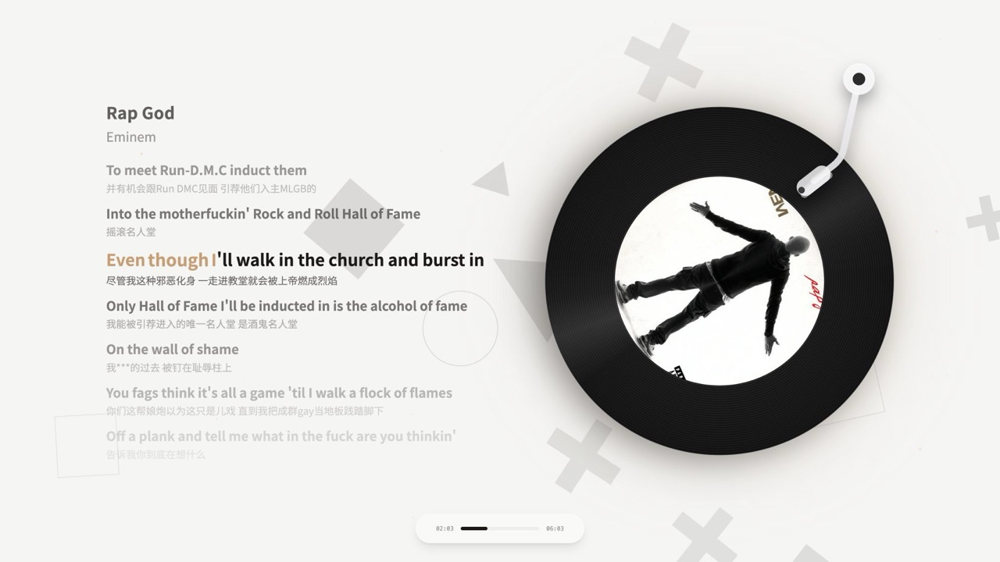

# 黑胶唱片 / vinyl-disc

一个 [Folia](https://github.com/chthollyphile/folia-major)（Folium 1 模组系统）模组：新增一个**歌词动画模式**「黑胶唱片」——选中它时，播放界面出现一张黑胶唱片（当前歌曲封面作碟心），播放时唱片旋转、唱臂落下，暂停时唱臂抬起、唱片停转，歌词排布在唱片一侧。效果参考 QQ 音乐 / 网易云音乐的黑胶播放页。

**不选中这个模式时完全不渲染**，与内置及其他模组的歌词样式互不影响。



## 使用

在播放界面的**动画模式选择器**里选「黑胶唱片」即可。切回其他模式，唱片立即消失。

## 功能

- **黑胶唱片**：压纹沟槽、固定高光、封面碟心、转轴孔；播放时匀速旋转，暂停时冻结（CSS 合成器动画，暂停零开销）。
- **唱臂**：经典浅白色，玻璃质感（半透明 + 高光 + 阴影模拟）；播放时落在黑胶沟槽上，暂停时抬起。
- **多行歌词**（QQ 音乐式）：当前句加粗高亮，前后各显示数行、随距离变淡变小；翻译显示在当前句下；可切**居左 / 居中**对齐；可选**频谱**条随音乐跳动（宿主分析器驱动，随帧衰减）。「歌名 - 歌手」组合形式的元数据行不会混进歌词；歌名 / 歌手本身作为歌词出现时正常显示。
- **逐字歌词**：有逐字时间轴的歌逐词点亮，已唱颜色取当前**封面主色**（无封面时退回主题强调色）。
- **歌词排版**：字号缩至约原来的 60% 再 70%、行距加大；歌名与当前句同字号，歌手为歌名的 80%。切歌时不再出现「先小后大」的跳变。
- **切歌自动换封面**：封面由宿主提供，切歌时宿主自动重挂载；无封面时碟心回退显示「歌名 / 歌手」。
- **主题联动**：文字颜色、字体栈、字重均取自当前主题；可选主题色光晕。

## 设置

在 **设置 → 模组** 展开「黑胶唱片」一行即可调整。改动先保存在草稿里，点**「保存」**后才应用到播放页（避免每改一项就实时重排、引起闪屏）；「恢复默认」一键还原。

| 设置 | 说明 |
| --- | --- |
| 唱片位置 | 歌词的左侧 / 右侧 |
| 唱片大小 | 直径占播放区高度的比例（默认 62%） |
| 旋转一圈（秒） | 6–60 秒；真黑胶 33⅓ 转约 1.8 秒一圈，默认放慢到 20 秒 |
| 封面占比 | 碟心封面占唱片直径的比例（默认 72%，接近参考效果） |
| 中心孔（黑色圆点） | 盖在封面正中的黑色转轴孔圆点；关掉后封面完整无孔 |
| 弥散投影 | 唱片背后的柔和光晕：关闭 / 跟随封面主色（默认）/ 主题色 |
| 唱臂 / 高光光泽 | 各元素的开关 |
| 歌词字号 | 叠加在主题字号与用户歌词字号之上 |
| 显示后续歌词 | 多行歌词视图中当前句之后的行 |
| 歌词对齐 | 歌词区内部居左 / 居中（不影响唱片位置） |

界面配色为黑白墨色样式，浅色 / 深色主题下都清晰；歌词颜色仍跟随当前主题。

## 安装

把 `vinyl-disc/` 文件夹放进 Folia 的模组目录后重启：

```
~/Library/Application Support/Folia/mods/vinyl-disc
```

首次启用时 Folia 会弹出确认窗口（列出内容指纹），确认后即可使用。

也可以在 Folia 的模组面板里直接把本仓库的 zip 拖进去安装。

## 模组市场

本模组已提交至 [folium-compound](https://github.com/chthollyphile/folium-compound) 模组市场收录流程（`模组提交` issue）。通过审查并签名后，可在 Folia 内置模组市场搜索「vinyl-disc / 黑胶唱片」安装，安装后显示官方签名标识。

## 实现说明

- 通过公开注册表 `folium.registries.visualizers` 注册一个动画模式（`hostLayers: { background: true, subtitles: false }`，歌词文本由模组自绘，避免与宿主字幕重复）。
- 歌词、时钟、封面、暂停、主题、字号都从 `FoliumStageContext` 读取（`lines` / `onLyricTime` / `getLineIndex` / `getCoverUrl` / `isPaused` / `getTheme` / `getDisplay` / `onResize` / `onChange`）。
- 旋转用 CSS 动画，唱臂是内联 SVG 绕支点旋转；配色与字体走主题，不写死。
- 不声明任何权限；不碰宿主 DOM、不注入全局样式、不联网。

## 权限

无。该模组只用动画模式注册表与上下文读取，不需要 `stageLayers`、`playback.read` 等任何权限。

## 隐私

不联网、不上传任何数据；设置由宿主保存在本机。

## 更新日志

- **1.7.7**：翻译改为跟随每一句歌词显示（多行视图里每句下方带各自的翻译，不再只有当前句）；修复唱针周围出现矩形瑕疵的问题（CSS drop-shadow 滤镜在元素框处裁剪，改用 SVG 内部滤镜）。
- **1.7.6**：逐字歌词改为平滑动画——已唱颜色随演唱进度在字内从左到右渐变擦入（不再一字一字硬切），正在演唱的字轻微放大弹跳。
- **1.7.5**：歌词 / 唱片距屏幕左右两侧的内边距加大到播放区宽度的 15%（7.5% → 15%）。
- **1.7.4**：歌词 / 唱片距屏幕左右两侧的边距加大到原来的 1.5 倍（5% → 7.5% 播放区宽度）。
- **1.7.3**：修复歌名 / 歌手本身作为歌词行时被误隐藏的问题（元数据过滤现在只拦「歌名 - 歌手」组合行）；修复打开播放页设置时歌词和唱片一起消失的问题（宿主折叠舞台尺寸到极小时不再重排，保持原布局）。
- **1.7.2**：唱臂恢复经典浅白色（不再跟随封面主色变色），保留落针位置与玻璃质感细节。
- **1.7.1**：唱臂玻璃效果退回纯透明模拟方案（高光 + 阴影 + 半透明），移除 backdrop-filter，避免潜在渲染/性能问题。
- **1.7.0**：移除频谱（效果不佳）；歌词字号再缩小到原来的 70%、行距加大；歌名字号与歌词一致、歌手为歌名的 80%；唱臂重做——落针位置改到黑胶沟槽（参考网易云移动版），玻璃质感（半透明 + 背景模糊 + 高光），颜色跟随当前封面主色。
- **1.6.0**：新增**逐字歌词**——有逐字时间轴的行逐词点亮，已唱部分取当前封面主色（无封面回退主题强调色）；歌词字号默认缩小到原来的约 60%；修复切歌时歌词「先小后大」的跳变（布局完成前不再渲染）。
- **1.5.0**：歌词改为 **QQ 音乐式多行视图**——当前句加粗、前后多行随距离淡出，元数据行（歌名 / 歌手）不再混入歌词；新增**歌词对齐**（居左 / 居中，仅歌词区内部）与**频谱**开关（歌词下方跳动条，宿主音频分析器驱动）。
- **1.4.2**：修复歌词间隙（宿主报 `-1` 时）仍露出空白、只剩歌名 / 歌手的问题——现在始终保留上一句歌词直到下一句出现；「中心孔」开关改为控制**盖在封面上的黑色转轴孔圆点**（此前误做成隐藏整个封面碟心）。
- **1.4.1**：间奏等空歌词行改为**保留上一句歌词**，直到下一句出现（与常见播放器一致）；唱臂恢复恒定浅色（不再随主题变色）；设置面板不再在主题变化时重建，消除模组列表滚动时的闪屏。
- **1.4.0**：设置面板改为「保存后生效」——自绘面板带**保存 / 恢复默认**按钮，改动不再实时写入，避免播放页闪屏；新增**碟心圆（模拟光盘）**开关，可隐藏唱片中间的封面圆；界面配色黑白自适应，浅色 / 深色主题下唱臂等元素都清晰可见。
- **1.3.3**：设置项改到**模组面板**——在「设置 → 模组」展开「黑胶唱片」即可调整（此前注册在动画模式自己的设置里，入口不明显）；修复空歌词行（间奏等）会显示「♪」占位符的问题。
- **1.3.2**：唱臂改为 7:3 比例——70% 直管 + 30% 短尾，肘部用二次贝塞尔圆滑过渡（不再有尖角）；弥散投影范围收窄到原来的 90%；预览图歌词改短，不再被碟片遮挡。
- **1.3.1**：唱臂弯折加强——上段保持近直，肘部约 40° 明显侧折再接唱头，贴近真实 S 形唱臂，不再像直线。
- **1.3.0**：唱片默认缩小到播放区高度的 62%；新增「弥散投影」——唱片背后一层柔和光晕，默认取当前封面的主色（24×24 降采样加权提取，本机完成，不联网），也可选主题色或关闭；唱臂加长约 50%（轴点外移、双段细杆），唱头落在封面边缘。
- **1.2.0**：按参考效果调整——碟心封面默认占比从 42% 提高到 72%（可调 50%–85%）；唱臂重绘为细浅色样式（小圆轴 + 双段细杆 + 胶囊唱头），与网易云风格一致。
- **1.1.0**：改为**动画模式**（此前误用播放页常驻图层，会叠在所有歌词模式上）。现在只有选中「黑胶唱片」时才出现，其他模式不受影响；同时补上歌词文本（曲名 / 当前句 / 翻译 / 下一句）与主题字体联动，移除 `stageLayers` 权限与独立设置分区（设置并入模式设置面板）。
- **1.0.0**：首个版本。

## 许可证

[MIT](vinyl-disc/LICENSE)
